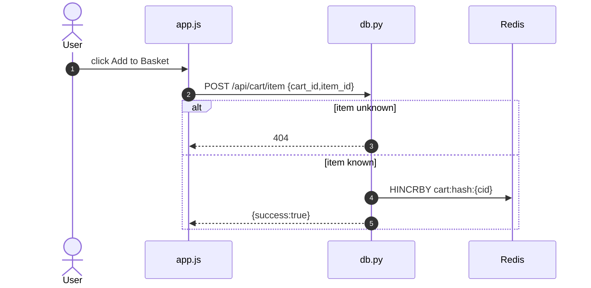
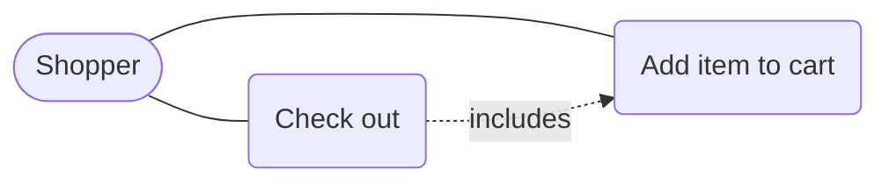
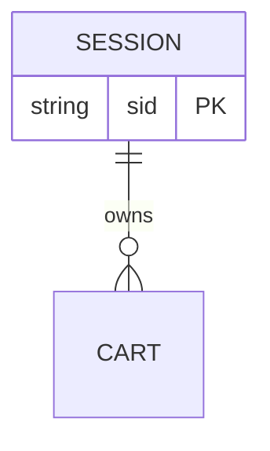

# explain-code

Goal: after using the outputs, the reader can explain every file, function, variable and data movement of the codebase to a jury as if they had written it. Three deliverables share ONE fact base, so they never contradict each other:

1. **Written guide** (step by step, file by file, with the relations between files).
2. **UML pack** (use case, component, sequence per feature, class/module, activity, state, data-store diagrams).
3. **Animated HTML explainer**: a fun, gamified, whimsical sequence diagram of how the files talk (start-up, every feature, what data moves, what is shared), in the arcade-violet look of the learning-animation-maker products.

Ask only what you cannot infer: audience level (default: a student who knows basic programming but not this stack), language of the output (default: the user's), format of the guide (default .docx via pandoc so it can be edited; use the Docs artifact type if the session lists it and the user did not ask for a file). Everything else: decide, state it, go.

## Phase 0. Read and run, never guess
- Read EVERY source file completely (code, config, HTML/CSS/JS, tests, scripts, Docker/compose files, data samples, README). Note line counts. Never explain from memory or from file names.
- If the code can run, RUN it (tests, a small script, the server plus a real request) and capture real values: ids, payloads, JSON answers, stored keys, timings. Payloads in diagrams and the explainer must come from a real run or from the code's own constants; label invented values 'example'.
- Search the code for what links files: imports, `src=`/`href=`, fetch/HTTP routes, function calls across files, environment variables, shared constants, files read or written, database keys/tables, message queues, CLI arguments.

## Phase 1. Fact ledger (the single source of truth)
Build a table before writing anything. One row per atomic item, verified against the code:

| Kind | What to record |
|---|---|
| File | path, language, one-sentence role, line count, who imports/loads it, what it is loaded by |
| Function / class | file, signature, what it receives, what it returns, side effects, who calls it, what it calls |
| Shared variable / constant | name, defined where, used where, meaning, lifetime (module global, env var, config) |
| Entry point / start-up order | the exact order things run from the first command to the ready state |
| Route / API / message | method + path or channel, caller, handler, request fields, answer fields |
| Data store item | key / table / file, type, who writes, who reads, expiry or lifetime |
| Operation / feature | a user-visible action mapped to its chain of files and functions |
| Limitation / trap | simplifications, races, known gaps, things a jury could ask |

Every later artefact is generated from this ledger. After writing, re-diff: any function, route or store item missing from the guide, a diagram or the explainer is a bug.

## Phase 2. The written guide (structure and rules)
Chapters, in this order (rename to fit the stack, keep the logic):
0. How to read this guide (order of reading, what you will be able to do).
1. The big picture: file table (file, language, one-sentence role), a text diagram of who talks to whom, the three or four 'important facts' (who is the only file that talks to the store, which file talks to the browser, what is reused by tests), the start-up order with real commands.
2. Primitives primer: the 10 to 15 commands/APIs/concepts the whole code is built from, in a table (what it does, where it is used), then a longer paragraph for each idea the jury will ask about (atomicity, TTL, transactions, async, caching, ...).
3. ONE action followed end to end (the key chapter): from the user's click or command through every file, function, request and store command and back, with real values, numbered steps, and how to watch it live (a monitor, a log, a debugger).
4. Each file, in execution order. For each: purpose, inputs and outputs, then a step-by-step walk. Quote short exact excerpts from the source, then explain line by line what each part does AND why it is written that way. State limitations honestly. End with 'link to the other files'.
5. Supporting files (tests, benchmarks, infrastructure): what each test or experiment proves and which result it feeds.
6. The master map: a table linking every user action to its front-end function, route, back-end function and store keys; and the reverse table (which function is used by the UI, the tests, the benchmarks).
7. Experiments the reader runs (8 to 10, each with the command and the expected result, plus one 'break it on purpose' exercise).
8. Self-test questions (about 12, answerable only if the reader understood the chapter) and a 'if I want to change X, edit Y' table.

Style: plain words first, then the exact term; define each term at first use; concrete values instead of 'some data'; explain WHY, not only what; never skip a line that does something non-obvious; keep each paragraph to one idea; use tables for mappings and numbered steps for sequences. Use the same names as the code. Build in stages (outline, then chapters). Output .docx with `pandoc guide.md -o guide.docx --toc` (check the page count and that tables and code survived) unless another format is chosen.

## Phase 3. The UML pack
Produce these diagrams from the ledger (skip one only if it truly does not apply, and say so). Every label is a real name from the code; one diagram = one idea; at most about 12 nodes; colours carry meaning, never alone.

| Diagram | Shows | Mermaid type |
|---|---|---|
| Use case | actors, their goals, include/extend | `flowchart LR` with `([actor])`, a `subgraph` system boundary |
| Component / file map | files, tiers, the arrows that carry data (labelled with the protocol or call) | `flowchart TB` with subgraphs |
| Sequence (one per feature, plus start-up) | messages in order between files/functions, alt/loop blocks for branches | `sequenceDiagram` with `autonumber` |
| Class / module | classes or modules with their public functions and dependencies | `classDiagram` |
| Activity / flow | the logic of ONE tricky function (branches, loops) | `flowchart TD` |
| State | lifecycle of an object (session, order, connection) | `stateDiagram-v2` |
| Data store / ER | keys, tables or collections, their fields and relations | `erDiagram` |
| Deployment (optional) | containers, ports, volumes, processes | `flowchart` |

Skeletons that are known to render (replace names with the real ones):







Render with `mmdc -i x.mmd -o x.svg -q` (and `.png` if the guide needs it). Validate EVERY diagram by rendering it; fix syntax errors (quote labels that contain `{}`, `/` or `:`). If `mmdc` is missing, draw clean inline SVG by hand. Put the diagrams in the guide (chapter 1, 3 and 4) and deliver the `.mmd` sources and `.svg` files as a zip so the reader can edit them.

## Phase 4. The animated HTML explainer
One self-contained HTML file (no network) with: an animated SEQUENCE view per feature (packets travel along arrows; payload shown in transit; call stack; shared state/stores table that flashes what changed), a FILE MAP view (every file as a box, every message path as an animated line with a count; click a line to read its messages, click a box to see what it defines, owns, reads and exports), a mascot narrator, plain-words captions, XP/levels/badges, a 'Quiz me' prediction mode, sound, read-aloud, confetti, scene cuts. It follows the quality and whimsy standards of /learning-animation-maker (violet arcade identity, readable, never flashing, chunky buttons, plain words first).

### 4.1 Author `data.json` (the only thing that changes between projects)
```json
{"title":"...","subtitle":"...",
 "actors":[{"id":"db.py","label":"db.py","sub":"server + Redis functions","kind":"user|browser|server|store|file","tier":2,
   "role":"one sentence","defines":["handle()"],"owns":["r (connection)","PRODUCTS"],"reads":["data/products.csv"],"exports":["JSON answers"]}],
 "initialState":{},
 "features":[{"id":"add","name":"2 · Add to Basket","summary":"one sentence","recap":["2 to 4 takeaways"],
  "steps":[{"from":"app.js","to":"db.py","kind":"call|return|event","fn":"addToCart()","label":"POST /api/cart/item",
    "plain":"everyday-words sentence (required, at most 220 characters, no code symbols)",
    "note":"the exact technical explanation","payload":{"cart_id":"visitor_482915"},
    "state":{"cart:hash:visitor_482915":"{16: 1}","gone:key":null}}]}]}
```
Rules:
- `tier` places a file in the File map: 0 = user, 1 = front end, 2 = server, 3 = stores and data files (left to right).
- One feature per user-visible operation, plus START-UP (what runs from the launch command to ready), plus any batch job, test run or background task that exists. At most 12 steps per feature: split a longer one.
- Steps are in true execution order. `from`/`to` are actor ids; a function that calls itself is `from == to`. Use `kind:"call"` only for a request that gets an answer, and give it a later `kind:"return"` step (the call stack pushes on call and pops on return); one-way sends are `event` (the default).
- `plain` explains in everyday words with a small analogy (a clerk, a shelf, an alarm clock), never reads symbols aloud, and comes FIRST on screen; `note` is the exact version. Both are required on every step.
- `payload` carries real values; `state` patches show what is stored after the step (value `null` deletes the key). Only the keys that changed.
- Every function, route, file and store key from the fact ledger appears in at least one step or in an actor's `defines`/`owns`.
- Each actor lists what it defines, owns (shared variables, keys, files), reads and exports: this is the 'what shared knowledge exists' panel.

### 4.2 Build
1. Fonts (inlined, no network): `mkdir fonts && cd fonts && npm pack @fontsource/nunito @fontsource/fredoka @fontsource/jetbrains-mono && for f in *.tgz; do mkdir x_${f%.tgz}; tar xzf $f -C x_${f%.tgz}; done`.
2. Save the template below as `template.html` and `build.py` as below, then `python3 build.py template.html data.json fonts out.html`.
3. Never hand-edit the output; edit `data.json`, rebuild.

`build.py`:
```python
"""build.py  <template.html> <data.json> <fonts_dir> <out.html>
Inlines the fonts (base64 woff2) and the data JSON into the template: ONE self-contained file, no network."""
import base64, json, sys, glob
tpl, data, fonts, out = sys.argv[1:5]
faces = []
for fam, name, weights in (("ML Sans", "nunito", (700, 900)), ("ML Display", "fredoka", (600,)), ("ML Mono", "jetbrains-mono", (500, 700))):
    for w in weights:
        f = glob.glob(f"{fonts}/**/{name}-latin-{w}-normal.woff2", recursive=True)[0]
        b64 = base64.b64encode(open(f, "rb").read()).decode()
        faces.append(f"@font-face{{font-family:'{fam}';font-weight:{w};src:url(data:font/woff2;base64,{b64}) format('woff2')}}")
html = open(tpl, encoding="utf-8").read().replace("/*__FONTS__*/", "".join(faces))
html = html.replace("__DATA__", json.dumps(json.load(open(data, encoding="utf-8")), ensure_ascii=False).replace("</", "<\\/"))
open(out, "w", encoding="utf-8").write(html)
print(out, round(len(html) / 1024), "KB")
```

`template.html` (copy verbatim; it is tested):
````html
<!DOCTYPE html>
<html lang="en"><head><meta charset="utf-8"><meta name="viewport" content="width=device-width,initial-scale=1">
<title>Code Flow Explainer</title>
<style>
/*__FONTS__*/
:root{color-scheme:dark;--bg:#0D0722;--tint:#2a1a6e;--panel:#1C1146;--panel2:#281A5C;--line:#4B3A96;--cream:#FFF7E6;--muted:#CBBFEA;--ink:#1A1033;--pink:#FF3D8B;--lime:#B6FF3B;--cyan:#2DE2FF;--yellow:#FFD23F;--orange:#FF9A45;--mint:#35E8A6;--sky:#4FC3FF;--lilac:#B79CFF;--coral:#FF6B7A;--purple:#7A3CFF;
--fs:'ML Sans','DejaVu Sans',system-ui,sans-serif;--fd:'ML Display','DejaVu Sans',system-ui,sans-serif;--fm:'ML Mono','DejaVu Sans Mono',ui-monospace,monospace}
*{box-sizing:border-box}[hidden]{display:none!important}
body{margin:0;min-height:100vh;color:var(--cream);font:700 15px/1.5 var(--fs);background:radial-gradient(1200px 700px at 50% -10%,var(--tint),var(--bg) 70%) fixed}
#deco{position:fixed;inset:0;width:100%;height:100%;pointer-events:none;opacity:.13;z-index:0}
header,main{position:relative;z-index:1}
header{padding:14px 16px 8px}.top{display:flex;align-items:center;gap:12px;flex-wrap:wrap}
h1{margin:0;font:600 22px/1.2 var(--fd)}.top p{margin:2px 0 0;color:var(--muted);font-size:14px}.sp{flex:1}
.cx-btn{font:600 14px/1 var(--fd);color:var(--ink);background:var(--cream);border:2px solid var(--ink);border-radius:12px;padding:9px 14px;cursor:pointer;box-shadow:0 3px 0 var(--ink)}
.cx-btn:hover{transform:translateY(-1px)}.cx-btn:active{transform:translateY(3px);box-shadow:none}
.cx-btn.pri{background:var(--pink)}.cx-btn.on{background:var(--lime)}
.cx-btn:disabled{background:#3A2E66;color:#D2C8F0;box-shadow:none;cursor:default}
.cx-btn:focus-visible,input:focus-visible,select:focus-visible{outline:3px solid var(--cyan);outline-offset:2px}
.pill{display:inline-flex;align-items:center;gap:8px;font:600 14px var(--fd);color:var(--ink);background:var(--yellow);border:2px solid var(--ink);border-radius:999px;padding:6px 12px;cursor:pointer;box-shadow:0 3px 0 var(--ink)}
.pill i{display:block;width:64px;height:8px;border-radius:9px;background:var(--ink);overflow:hidden}.pill i b{display:block;height:100%;background:var(--lime);width:0}
.tabs{display:flex;flex-wrap:wrap;gap:8px;margin-top:10px}
.tab{position:relative;overflow:hidden;font:600 14px/1 var(--fd);color:var(--cream);background:var(--panel);border:2px solid var(--line);border-radius:12px;padding:10px 14px 14px;cursor:pointer}
.tab.on{background:var(--panel2);border-color:var(--cream)}.tab i{position:absolute;left:0;bottom:0;height:5px;width:0;background:var(--lime)}
.ctl{display:flex;flex-wrap:wrap;gap:8px;align-items:center;margin-top:10px}.ctl label{color:var(--muted);font-size:14px}
input[type=range]{accent-color:var(--pink)}select{font:600 14px var(--fd);color:var(--ink);background:var(--cream);border:2px solid var(--ink);border-radius:10px;padding:6px 8px}
main{display:grid;grid-template-columns:minmax(0,1fr) 360px;gap:14px;padding:6px 16px 24px}
@media(max-width:940px){main{grid-template-columns:1fr}}
.card{background:var(--panel);border-radius:18px;padding:14px;min-width:0;box-shadow:0 0 0 2px rgba(255,247,230,.16),0 10px 30px rgba(0,0,0,.35)}
.card h3{margin:0 0 8px;font:600 13px var(--fd);letter-spacing:.08em;text-transform:uppercase;color:var(--muted)}
#stage{overflow:auto;max-height:68vh;border-radius:12px}svg{display:block}svg text{font:600 14px var(--fs);fill:var(--cream)}
.cut{animation:cut .45s ease-out}@keyframes cut{from{transform:scale(.94) rotate(-1deg);opacity:0}to{transform:none;opacity:1}}
.mut{fill:var(--muted)!important;font-weight:700}.life{stroke:var(--line);stroke-width:2;stroke-dasharray:5 6}
.halo{paint-order:stroke;stroke:var(--panel);stroke-width:6px;stroke-linejoin:round}
.node{cursor:pointer}.node rect{fill:var(--panel2);stroke-width:3}.node.act rect{stroke:var(--pink);fill:#3a2680}
.fd{font-family:var(--fd)!important;font-weight:600!important}.mono{font-family:var(--fm)!important}
.who{display:flex;gap:10px;align-items:flex-start}
.bubble{position:relative;flex:1;min-width:0;background:var(--panel2);border-radius:16px;padding:10px 12px}
.bubble:before{content:"";position:absolute;left:-8px;top:22px;border:8px solid transparent;border-left:0;border-right-color:var(--panel2)}
.kick{font:600 13px var(--fd);color:var(--muted);letter-spacing:.06em;text-transform:uppercase;margin-bottom:6px}
.plainbox{background:var(--cream);color:var(--ink);border-radius:12px;padding:8px 10px;margin:4px 0 8px}
.plainbox b{display:inline-block;font:600 12px var(--fd);background:var(--ink);color:var(--yellow);border-radius:999px;padding:2px 9px;margin-bottom:4px}
.plainbox p{margin:0;font-size:15px;line-height:1.45}.tech{font-size:13px;color:var(--muted);line-height:1.5}
.tech code{font:700 12.5px var(--fm);color:var(--cyan)}
pre{margin:0;white-space:pre-wrap;word-break:break-all;background:var(--bg);color:var(--cream);padding:8px;border-radius:10px;font:500 12.5px/1.5 var(--fm)}
ul.recap{margin:6px 0 0;padding-left:20px;color:var(--cream)}ul.recap li{margin:3px 0}
table{width:100%;border-collapse:collapse;font:500 12.5px var(--fm)}td{padding:4px;border-bottom:1px solid var(--line);vertical-align:top;overflow-wrap:anywhere;color:var(--cream)}td:first-child{color:var(--muted);width:42%}
tr.chg td{background:var(--yellow);color:var(--ink)}
.stk div{padding:4px 8px;border-left:4px solid var(--cyan);margin:4px 0;background:var(--bg);border-radius:0 8px 8px 0;font:500 12.5px var(--fm);color:var(--cream)}
.mutetxt{color:var(--muted)}
#ask{margin-top:10px;background:var(--panel2);border-radius:14px;padding:10px 12px}#ask p{margin:0 0 8px;font-weight:900}#ask .opts{display:flex;flex-wrap:wrap;gap:8px}#ask .fb{margin-top:8px;font-size:14px}
.side{display:flex;flex-direction:column;gap:14px}
.flow{stroke-dasharray:6 6;animation:dash 1s linear infinite}@keyframes dash{to{stroke-dashoffset:-12}}
.mascot{animation:bob 2.4s ease-in-out infinite;flex:none}@keyframes bob{50%{transform:translateY(-4px)}}
.eyes{animation:blink 4.5s infinite;transform-origin:32px 31px}@keyframes blink{94%,100%{transform:scaleY(1)}97%{transform:scaleY(.1)}}
.mouth-sad{display:none}.no .mouth{display:none}.no .mouth-sad{display:inline}
.talk .mouth{animation:talk .3s infinite alternate;transform-origin:32px 40px}@keyframes talk{to{transform:scaleY(.55)}}
#toast{position:fixed;left:50%;bottom:22px;transform:translateX(-50%);background:var(--cream);color:var(--ink);font:600 15px var(--fd);border-radius:14px;padding:10px 16px;box-shadow:0 4px 0 var(--ink);z-index:30}
.xpf{position:fixed;font:600 18px var(--fd);color:var(--lime);z-index:30;pointer-events:none;animation:up 1.1s ease-out forwards}@keyframes up{to{transform:translateY(-46px);opacity:0}}
.conf{position:fixed;top:-12px;width:9px;height:14px;z-index:30;pointer-events:none;animation:fall 1.9s ease-in forwards}@keyframes fall{to{transform:translateY(105vh) rotate(540deg);opacity:.9}}
#prog{position:fixed;inset:0;background:rgba(13,7,34,.82);z-index:20;display:flex;align-items:center;justify-content:center;padding:16px}
#prog .card{max-width:440px;width:100%;background:var(--panel2)}#prog p{margin:6px 0}
.qa *,.qa *:before{animation:none!important}.qa .flow{animation:none!important}
@media(prefers-reduced-motion:reduce){*,*:before{animation:none!important}}
</style></head><body>
<svg id="deco" aria-hidden="true"></svg>
<header>
 <div class="top"><div><h1 id="title"></h1><p id="sub"></p></div><span class="sp"></span><button id="xp" class="pill" aria-label="Open progress">Lv <span id="lvl">1</span> &middot; <span id="xpn">0</span> XP <i><b id="xpbar"></b></i></button></div>
 <div class="tabs" id="tabs"></div>
 <div class="ctl"><button id="vseq" class="cx-btn on">Sequence</button><button id="vmap" class="cx-btn">File map</button>
  <span id="ctl" class="ctl" style="margin:0"><button id="prev" class="cx-btn" aria-label="Previous step">&#9664;</button><button id="play" class="cx-btn pri">&#9654; Play</button><button id="next" class="cx-btn" aria-label="Next step">&#9654;</button>
  <input id="scrub" type="range" min="-1" value="-1" style="width:130px" aria-label="Step"><label>Speed <select id="spd"><option>0.5</option><option selected>1</option><option>2</option><option>4</option></select></label></span>
  <button id="ask-btn" class="cx-btn">Quiz me</button><button id="snd" class="cx-btn on">Sound on</button><button id="voice" class="cx-btn">Read aloud</button>
  <select id="vsel" hidden aria-label="Voice"></select></div>
</header>
<main><div class="card"><div id="stage"></div><div id="ask" hidden></div></div>
<div class="side">
 <div class="card"><div class="who" id="who"><svg class="mascot" viewBox="0 0 64 64" width="64" height="64" aria-hidden="true"><line x1="32" y1="4" x2="32" y2="13" stroke="#FFF7E6" stroke-width="3" stroke-linecap="round"/><circle cx="32" cy="5" r="4" fill="#FF3D8B"/><rect x="8" y="13" width="48" height="40" rx="14" fill="#281A5C" stroke="#FFF7E6" stroke-width="2.5"/><rect x="14" y="20" width="36" height="26" rx="9" fill="#0D0722"/><g class="eyes"><circle cx="25" cy="31" r="4" fill="#2DE2FF"/><circle cx="39" cy="31" r="4" fill="#2DE2FF"/></g><path class="mouth" d="M25 39 Q32 46 39 39" fill="none" stroke="#B6FF3B" stroke-width="3" stroke-linecap="round"/><path class="mouth-sad" d="M25 43 Q32 37 39 43" fill="none" stroke="#FF6B7A" stroke-width="3" stroke-linecap="round"/><rect x="2" y="26" width="6" height="12" rx="3" fill="#7A3CFF"/><rect x="56" y="26" width="6" height="12" rx="3" fill="#7A3CFF"/></svg>
  <div class="bubble"><div class="kick" id="hstep"></div><div id="note"></div></div></div></div>
 <div class="card"><h3>Data in transit</h3><pre id="payload">-</pre></div>
 <div class="card"><h3>Call stack</h3><div class="stk" id="stack"></div></div>
 <div class="card"><h3>Shared state / stores</h3><table id="state"></table></div>
 <div class="card"><h3 id="hinfo">Click a file</h3><div id="info" class="mutetxt">Click a file header (or a box in the file map) to see what it owns, reads and exports.</div></div>
</div></main>
<div id="prog" hidden><div class="card"><h3>Your progress</h3><div id="progbody"></div><p><button id="progx" class="cx-btn pri">Close</button></p></div></div>
<script id="app-data" type="application/json">__DATA__</script>
<script>
const D=JSON.parse(document.getElementById('app-data').textContent),$=s=>document.querySelector(s),NS='http://www.w3.org/2000/svg';
const qa=/[?&]qa=1/.test(location.search)||matchMedia('(prefers-reduced-motion:reduce)').matches;if(qa)document.documentElement.classList.add('qa');
const el=(t,a,p)=>{const e=document.createElementNS(NS,t);for(const k in a)e.setAttribute(k,a[k]);p&&p.appendChild(e);return e};
const esc=x=>String(x).replace(/[&<>]/g,c=>({'&':'&amp;','<':'&lt;','>':'&gt;'}[c]));
const KC={user:'#FFD23F',browser:'#4FC3FF',server:'#B6FF3B',store:'#FF9A45',file:'#B79CFF'},col=a=>KC[a.kind]||KC.file;
const FD="600 14px 'ML Display','DejaVu Sans',sans-serif",cv=document.createElement('canvas').getContext('2d'),tw=(t,f=FD)=>(cv.font=f,cv.measureText(t).width);
const A=Object.fromEntries(D.actors.map(a=>[a.id,a])),nm=id=>A[id].label||id;
const TINT=['#2a1a6e','#4a1650','#14316b','#5b1840','#0f4a4f','#5a3410','#3a1d8a','#164a2c'];
let view='seq',fi=0,si=-1,playing=false,tm=null,raf=null,predict=false,voiceOn=false,asking=null,snd=true,AC=null;
const F=()=>D.features[fi],S=()=>F().steps,sp=()=>+$('#spd').value,readMs=t=>Math.min(7500,Math.max(1700,900+46*t.length));
/* ---------- progress, XP (each reward only once) ---------- */
const SK='cfx:'+D.title;let P={xp:0,once:{},seen:{}};try{P={...P,...JSON.parse(localStorage.getItem(SK)||'{}')}}catch(e){}
const save=()=>{try{localStorage.setItem(SK,JSON.stringify(P))}catch(e){}};
const LV=['Rookie','Scout','Tracer','Debugger','Architect','Legend'],lvl=()=>Math.floor(P.xp/100);
function xpHud(){$('#lvl').textContent=lvl()+1;$('#xpn').textContent=P.xp;$('#xpbar').style.width=(P.xp%100)+'%';
 [...$('#tabs').children].forEach((b,i)=>{const n=D.features[i].steps.length;let c=0;for(let k=0;k<n;k++)if(P.seen[i+':'+k])c++;b.querySelector('i').style.width=(100*c/n)+'%'})}
function toast(t){const e=$('#toast')||Object.assign(document.body.appendChild(document.createElement('div')),{id:'toast'});e.textContent=t;e.hidden=false;clearTimeout(e._t);e._t=setTimeout(()=>e.hidden=true,2600)}
function confetti(){if(qa)return;const cs=['#FF3D8B','#B6FF3B','#2DE2FF','#FFD23F','#B79CFF'];for(let i=0;i<40;i++){const d=document.createElement('div');d.className='conf';d.style.cssText=`left:${Math.random()*100}vw;background:${cs[i%5]};animation-delay:${Math.random()*.5}s`;document.body.appendChild(d);setTimeout(()=>d.remove(),2600)}}
function once(key,n,why){if(P.once[key])return;P.once[key]=1;const before=lvl();P.xp+=n;save();xpHud();
 if(!qa){const f=document.createElement('div');f.className='xpf';f.textContent='+'+n+' XP';const r=$('#xp').getBoundingClientRect();f.style.cssText=`left:${r.left}px;top:${r.bottom+4}px`;document.body.appendChild(f);setTimeout(()=>f.remove(),1200)}
 if(lvl()>before){toast('Level up! You are now a '+LV[Math.min(5,lvl())]);confetti();tone('win')}else if(why)toast(why)}
/* ---------- sound + voice ---------- */
function beep(f,d=.12,v=.05,w=0){if(!snd||qa)return;try{AC=AC||new(window.AudioContext||window.webkitAudioContext)();const o=AC.createOscillator(),g=AC.createGain(),t=AC.currentTime+w;o.frequency.value=f;g.gain.value=v;o.connect(g);g.connect(AC.destination);o.start(t);g.gain.exponentialRampToValueAtTime(.0001,t+d);o.stop(t+d)}catch(e){}}
const tone=k=>k==='call'?beep(420):k==='ret'?beep(660):k==='ok'?(beep(523,.1),beep(784,.14,.05,.1)):k==='no'?beep(180,.2):(beep(523,.1),beep(659,.1,.05,.1),beep(988,.2,.05,.2));
const clean=t=>t.replace(/→|->/g,' to ').replace(/[`<>{}]/g,' ').replace(/\(\)/g,'').replace(/\s+/g,' ');
function fillVoices(){const v=speechSynthesis.getVoices().sort((a,b)=>(/^en/.test(b.lang)-/^en/.test(a.lang))||a.name.localeCompare(b.name));$('#vsel').innerHTML='<option value="">Browser default</option>'+v.map(x=>`<option>${esc(x.name)}</option>`).join('')}
if('speechSynthesis'in window){fillVoices();speechSynthesis.onvoiceschanged=fillVoices}
function speak(t,end){if(!('speechSynthesis'in window))return end&&end();speechSynthesis.cancel();const u=new SpeechSynthesisUtterance(clean(t)),v=speechSynthesis.getVoices().find(x=>x.name===$('#vsel').value);if(v)u.voice=v;u.rate=Math.min(2,Math.max(.5,sp()));u.onend=u.onerror=()=>end&&end();speechSynthesis.speak(u)}
const mood=m=>{const w=$('#who');w.classList.toggle('talk',m==='talk');w.classList.toggle('no',m==='no')};
/* ---------- tabs + background decoration ---------- */
D.features.forEach((f,i)=>{const b=document.createElement('button');b.className='tab';b.innerHTML=esc(f.name)+'<i></i>';b.onclick=()=>{fi=i;si=-1;stop();draw()};$('#tabs').appendChild(b)});
$('#title').textContent=D.title;$('#sub').textContent=D.subtitle||'';document.title=D.title;
(()=>{const s=$('#deco');s.setAttribute('viewBox','0 0 100 100');s.setAttribute('preserveAspectRatio','none');const cs=['#FF3D8B','#B6FF3B','#2DE2FF','#FFD23F','#B79CFF','#7A3CFF'];for(let i=0;i<14;i++){const x=(i*37)%100,y=(i*53)%100,r=2+(i%4),c=cs[i%6];i%3===0?el('circle',{cx:x,cy:y,r,fill:c},s):i%3===1?el('rect',{x,y,width:r*1.6,height:r*1.6,rx:1,fill:c},s):el('path',{d:`M${x} ${y-r}L${x+r*.4} ${y-r*.3}L${x+r} ${y}L${x+r*.4} ${y+r*.3}L${x} ${y+r}L${x-r*.4} ${y+r*.3}L${x-r} ${y}L${x-r*.4} ${y-r*.3}Z`,fill:c},s)}})();
function used(){const ids=new Set();S().forEach(s=>{ids.add(s.from);ids.add(s.to)});return D.actors.filter(a=>ids.has(a.id))}
function draw(){document.documentElement.style.setProperty('--tint',F().tint||TINT[fi%TINT.length]);
 [...$('#tabs').children].forEach((b,i)=>b.classList.toggle('on',i===fi));$('#ctl').style.display=view==='seq'?'':'none';$('#tabs').style.display=view==='seq'?'':'none';
 $('#scrub').max=S().length-1;$('#scrub').value=si;$('#ask').hidden=true;asking=null;
 if(view==='seq'){seq();panels()}else map();xpHud();const st=$('#stage');st.classList.remove('cut');void st.offsetWidth;if(!qa)st.classList.add('cut')}
/* ---------- sequence diagram ---------- */
const ROW=84,GAP=236,X0=120;let X={};
function icon(k,x,y,c,g){const o={fill:'none',stroke:c,'stroke-width':2.2,'stroke-linecap':'round','stroke-linejoin':'round'};
 if(k==='user'){el('circle',{...o,cx:x,cy:y-4,r:4},g);el('path',{...o,d:`M${x-8} ${y+9}q8-12 16 0`},g)}
 else if(k==='browser'){el('rect',{...o,x:x-9,y:y-7,width:18,height:14,rx:3},g);el('path',{...o,d:`M${x-9} ${y-2}h18`},g)}
 else if(k==='server'){el('rect',{...o,x:x-9,y:y-8,width:18,height:6,rx:2},g);el('rect',{...o,x:x-9,y:y+1,width:18,height:6,rx:2},g)}
 else if(k==='store'){el('ellipse',{...o,cx:x,cy:y-5,rx:9,ry:3.5},g);el('path',{...o,d:`M${x-9} ${y-5}v10c0 4 18 4 18 0v-10`},g)}
 else el('path',{...o,d:`M${x-6} ${y-8}h8l5 5v11h-13z`},g)}
function seq(){const st=$('#stage');st.innerHTML='';const ac=used(),W=X0*2+GAP*(ac.length-1),H=120+S().length*ROW+30;
 const svg=el('svg',{width:Math.max(W,640),height:H,id:'svg'},st),df=el('defs',{},svg);
 ['call:#2DE2FF','ret:#35E8A6'].forEach(k=>{const[n,c]=k.split(':'),m=el('marker',{id:'m'+n,viewBox:'0 0 10 10',refX:9,refY:5,markerWidth:7,markerHeight:7,orient:'auto-start-reverse'},df);el('path',{d:'M0 0L10 5L0 10z',fill:c},m)});
 el('filter',{id:'glow',x:'-50%',y:'-50%',width:'200%',height:'200%'},df).innerHTML='<feGaussianBlur stdDeviation="3.5"/>';
 ac.forEach((a,i)=>{X[a.id]=X0+i*GAP;const g=el('g',{class:'node',id:'n-'+a.id,tabindex:0},svg);g.onclick=()=>info(a.id);g.onkeydown=e=>e.key==='Enter'&&info(a.id);
  el('line',{x1:X[a.id],x2:X[a.id],y1:62,y2:H-10,class:'life'},svg);svg.appendChild(g);el('rect',{x:X[a.id]-84,y:8,width:168,height:54,rx:14,stroke:col(a)},g);icon(a.kind,X[a.id]-62,28,col(a),g);
  const t=el('text',{x:X[a.id]+8,y:30,'text-anchor':'middle',class:'fd'},g);t.textContent=a.label||a.id;const r=el('text',{x:X[a.id]+8,y:48,'text-anchor':'middle',class:'mut'},g);r.style.fontSize='12.5px';r.textContent=a.sub||a.kind});
 S().forEach((s,i)=>{const y=118+i*ROW,g=el('g',{id:'a'+i},svg),self=s.from===s.to,ret=s.kind==='return',c=ret?'#35E8A6':'#2DE2FF',x1=X[s.from],x2=X[s.to];
  if(self)el('path',{d:`M${x1} ${y-8}h54v28h-54`,fill:'none',stroke:c,'stroke-width':3,'stroke-linecap':'round','marker-end':'url(#mcall)'},g);
  else el('line',{x1,x2:x2+(x2>x1?-3:3),y1:y,y2:y,stroke:c,'stroke-width':3,'stroke-linecap':'round','stroke-dasharray':ret?'7 5':'','marker-end':`url(#m${ret?'ret':'call'})`},g);
  const tx=self?x1+64:(x1+x2)/2,an=self?'start':'middle',L=el('g',{class:'lab'},g);
  const t=el('text',{x:tx,y:y-26,'text-anchor':an,class:'fd halo'},L);t.textContent=(s.n||i+1)+'. '+(s.fn||s.label);
  if(s.fn&&s.label){const u=el('text',{x:tx,y:y-9,'text-anchor':an,class:'mut halo'},L);u.style.fontSize='12.5px';u.textContent=s.label}});
 el('circle',{id:'tr3',r:5,fill:'#FF3D8B',opacity:0},svg);el('circle',{id:'tr2',r:6.5,fill:'#FF3D8B',opacity:0},svg);el('circle',{id:'tr1',r:8,fill:'#FF3D8B',opacity:0},svg);
 const pk=el('g',{id:'pk',opacity:0},svg);el('circle',{r:13,fill:'#FF3D8B',filter:'url(#glow)',opacity:.7},pk);el('circle',{r:9,fill:'#FF3D8B',stroke:'#FFF7E6','stroke-width':2.5},pk);
 const pp=el('g',{id:'pkl',opacity:0},svg);el('rect',{id:'pkr',height:24,rx:12,fill:'#281A5C',stroke:'#FF3D8B','stroke-width':2},pp);const pt=el('text',{id:'pkt','text-anchor':'middle',class:'fd'},pp);pt.setAttribute('y',17);
 el('circle',{id:'ring',r:8,fill:'none',stroke:'#FF3D8B','stroke-width':3,opacity:0},svg);paint()}
function paint(){S().forEach((s,i)=>{const g=$('#a'+i);if(!g)return;const L=g.querySelector('.lab');L.style.display=i>si?'none':'';g.setAttribute('opacity',i>si?.3:1);
  g.querySelectorAll('line,path').forEach(e=>e.setAttribute('stroke-width',i===si?4.5:3));
  L.querySelectorAll('text').forEach((t,k)=>{if(i===si){t.style.fill='#FFF7E6'}else{t.style.fill='#CBBFEA'}})});
 D.actors.forEach(a=>{const n=$('#n-'+a.id);if(n)n.classList.toggle('act',si>=0&&(S()[si].to===a.id||S()[si].from===a.id))});
 const sc=$('#stage'),r=$('#a'+si);if(r&&si>=0){const y=118+si*ROW;if(y<sc.scrollTop+90||y>sc.scrollTop+sc.clientHeight-70)sc.scrollTo({top:Math.max(0,y-150),behavior:qa?'auto':'smooth'})}}
function packet(s,i,done){cancelAnimationFrame(raf);const y=118+i*ROW,x1=X[s.from],x2=X[s.to],pk=$('#pk');if(!pk||qa)return done&&done();
 const lab=s.packet||(s.payload?Object.keys(s.payload).slice(0,2).join(', '):''),pt=$('#pkt'),pr=$('#pkr'),pl=$('#pkl');pt.textContent=lab;const w=lab?tw(lab)+22:0;pr.setAttribute('width',w);pr.setAttribute('x',-w/2);pl.setAttribute('opacity',lab?1:0);pk.setAttribute('opacity',1);
 const T=800/sp(),t0=performance.now();
 (function f(t){const p=Math.min(1,(t-t0)/T),[x,yy]=s.from===s.to?[x1+27*Math.sin(p*Math.PI),y+p*10]:[x1+(x2-x1)*p,y];pk.setAttribute('transform',`translate(${x},${yy})`);pl.setAttribute('transform',`translate(${x},${yy+30})`);
  [1,2,3].forEach(k=>{const q=Math.max(0,p-.07*k),e=$('#tr'+k);e.setAttribute('cx',s.from===s.to?x1+27*Math.sin(q*Math.PI):x1+(x2-x1)*q);e.setAttribute('cy',yy);e.setAttribute('opacity',.5/k)});
  if(p<1)raf=requestAnimationFrame(f);else{pk.setAttribute('opacity',0);pl.setAttribute('opacity',0);[1,2,3].forEach(k=>$('#tr'+k).setAttribute('opacity',0));const r=$('#ring');r.setAttribute('cx',x2);r.setAttribute('cy',y);r.setAttribute('opacity',1);r.animate([{r:8,opacity:1},{r:30,opacity:0}],{duration:450}).onfinish=()=>r.setAttribute('opacity',0);done&&done()}})(t0)}
/* ---------- side panels ---------- */
function panels(){const s=si>=0?S()[si]:null,last=si===S().length-1;$('#hstep').textContent=s?`Step ${si+1} of ${S().length}`:F().name;
 let h;if(s)h=`<div class="plainbox"><b>In plain words</b><p>${esc(s.plain||s.note||'')}</p></div><div class="tech"><code>${esc(nm(s.from))} &rarr; ${esc(nm(s.to))}</code>${s.fn?' &middot; <code>'+esc(s.fn)+'</code>':''}<br>${esc(s.note||'')}</div>`;
 else h=`<div class="plainbox"><b>In plain words</b><p>${esc(F().summary||'')}</p></div><div class="tech">Press Play, use the arrow keys, or switch on Quiz me to guess each next message.</div>`;
 if(last&&F().recap)h+=`<div class="tech"><b class="fd">What to remember</b><ul class="recap">${F().recap.map(r=>`<li>${esc(r)}</li>`).join('')}</ul></div>`;
 $('#note').innerHTML=h;$('#payload').textContent=s&&s.payload?JSON.stringify(s.payload,null,1):'-';
 const stack=[];for(let i=0;i<=si;i++){const x=S()[i];if(x.kind==='return')stack.pop();else if(x.kind==='call')stack.push(nm(x.to)+' :: '+(x.fn||x.label))}
 $('#stack').innerHTML=stack.length?stack.slice().reverse().map(t=>`<div>${esc(t)}</div>`).join(''):'<span class="mutetxt">(empty)</span>';
 const st={...(D.initialState||{})},ch=new Set();for(let i=0;i<=si;i++){const p=S()[i].state||{};for(const k in p){if(p[k]===null)delete st[k];else st[k]=p[k];if(i===si)ch.add(k)}}
 $('#state').innerHTML=Object.keys(st).length?Object.keys(st).map(k=>`<tr class="${ch.has(k)?'chg':''}"><td>${esc(k)}</td><td>${esc(st[k])}</td></tr>`).join(''):'<tr><td colspan=2 class="mutetxt">(nothing stored yet)</td></tr>';$('#scrub').value=si}
function info(id){const a=A[id],li=(t,x)=>x&&x.length?`<p><b class="fd">${t}</b></p><ul>${x.map(i=>`<li><code>${esc(i)}</code></li>`).join('')}</ul>`:'';
 $('#hinfo').textContent=a.label||a.id;$('#info').className='';$('#info').innerHTML=`<p>${esc(a.role||'')}</p>`+li('Defines (functions / classes)',a.defines)+li('Owns (shared variables, keys, data)',a.owns)+li('Reads / imports from',a.reads)+li('Sends out / exports',a.exports)}
/* ---------- stepping, quiz-me, autoplay ---------- */
function go(i){si=Math.max(-1,Math.min(S().length-1,i));if(view!=='seq')return;paint();panels();if(si<0)return mood('');
 const s=S()[si];tone(s.kind==='return'?'ret':'call');mood('talk');packet(s,si,()=>mood(''));
 if(!P.seen[fi+':'+si]){P.seen[fi+':'+si]=1;once('s'+fi+':'+si,2)}
 if(si===S().length-1){once('f'+fi,50,'Flow complete: '+F().name);if(P.once['f'+fi]&&!qa)confetti()}xpHud()}
function request(i){if(predict&&i===si+1&&i<S().length)ask(i);else go(i)}
function ask(i){stop();const s=S()[i],ac=used(),box=$('#ask');asking=i;let tries=0;box.hidden=false;setTimeout(()=>box.scrollIntoView({block:'nearest'}),0);
 box.innerHTML=`<p>Bolt asks: step ${i+1} is next. Which file receives this message?</p><div class="opts">${ac.map(a=>`<button class="cx-btn" data-id="${esc(a.id)}">${esc(nm(a.id))}</button>`).join('')}</div><div class="fb" id="fb"></div>`;
 box.querySelectorAll('button').forEach(b=>b.onclick=()=>{if(b.dataset.id===s.to){tone('ok');mood('');box.hidden=true;asking=null;if(!tries)once('q'+fi+':'+i,10,'Correct! +10 XP');go(i)}
  else{tries++;tone('no');mood('no');b.disabled=true;$('#fb').textContent=tries>1?`The answer is ${nm(s.to)}. Watch why.`:`Not quite. Hint: ${nm(s.from)} is the sender${s.fn?' and it calls '+s.fn:''}.`;if(tries>1){box.hidden=true;asking=null;go(i)}}})}
function stop(){playing=false;clearTimeout(tm);if('speechSynthesis'in window)speechSynthesis.cancel();$('#play').innerHTML='&#9654; Play'}
function tick(){if(!playing)return;if(si>=S().length-1)return stop();const nx=si+1;if(predict&&S()[nx]&&!P.once['q'+fi+':'+nx]){ask(nx);const b=$('#ask');const o=new MutationObserver(()=>{if(b.hidden){o.disconnect();playing=true;$('#play').innerHTML='&#10073;&#10073; Pause';wait()}});o.observe(b,{attributes:true});return}
 go(nx);wait()}
function wait(){const s=S()[si],txt=(s.plain||'')+' '+(s.note||'');if(voiceOn&&!qa)speak(s.plain||s.note,()=>{if(playing)tm=setTimeout(tick,700)});else tm=setTimeout(tick,Math.max(1800,readMs(txt))/sp())}
$('#play').onclick=()=>{if(playing)return stop();if(si>=S().length-1)si=-1;$('#ask').hidden=true;playing=true;$('#play').innerHTML='&#10073;&#10073; Pause';tick()};
$('#next').onclick=()=>{stop();request(si+1)};$('#prev').onclick=()=>{stop();$('#ask').hidden=true;go(si-1)};$('#scrub').oninput=e=>{stop();$('#ask').hidden=true;go(+e.target.value)};
$('#vseq').onclick=()=>{view='seq';$('#vseq').classList.add('on');$('#vmap').classList.remove('on');draw()};$('#vmap').onclick=()=>{stop();view='map';$('#vmap').classList.add('on');$('#vseq').classList.remove('on');draw()};
$('#ask-btn').onclick=e=>{predict=!predict;e.target.classList.toggle('on',predict);e.target.textContent=predict?'Quiz me: on':'Quiz me'};
$('#snd').onclick=e=>{snd=!snd;e.target.classList.toggle('on',snd);e.target.textContent=snd?'Sound on':'Sound off'};
$('#voice').onclick=e=>{voiceOn=!voiceOn;e.target.classList.toggle('on',voiceOn);e.target.textContent=voiceOn?'Reading aloud':'Read aloud';$('#vsel').hidden=!voiceOn;if(!voiceOn&&'speechSynthesis'in window)speechSynthesis.cancel()};
$('#xp').onclick=()=>{const done=D.features.map((f,i)=>`<p>${P.once['f'+i]?'&#10003;':'&#9675;'} ${esc(f.name)}${P.once['f'+i]?' (badge earned)':''}</p>`).join('');
 $('#progbody').innerHTML=`<p class="fd" style="font-size:20px">Level ${lvl()+1}: ${LV[Math.min(5,lvl())]} &middot; ${P.xp} XP</p><p>How to earn XP: +2 the first time you see a step, +10 for guessing a next message right (Quiz me), +50 for finishing a flow. Each reward counts once, and a new level comes every 100 XP.</p>${done}`;$('#prog').hidden=false;$('#progx').focus()};
$('#progx').onclick=()=>$('#prog').hidden=true;
document.onkeydown=e=>{if(e.key==='Escape')$('#prog').hidden=true;if(['SELECT','INPUT'].includes(e.target.tagName))return;if(e.key===' '){e.preventDefault();$('#play').click()}if(e.key==='ArrowRight')$('#next').click();if(e.key==='ArrowLeft')$('#prev').click()};
/* ---------- file map ---------- */
function map(){const st=$('#stage');st.innerHTML='';const tiers=[...new Set(D.actors.map(a=>a.tier??1))].sort(),pos={},NW=176;
 tiers.forEach((t,ti)=>D.actors.filter(a=>(a.tier??1)===t).forEach((a,r)=>pos[a.id]={x:24+ti*280,y:28+r*120}));
 const W=48+tiers.length*280,H=60+Math.max(...tiers.map(t=>D.actors.filter(a=>(a.tier??1)===t).length))*120,svg=el('svg',{viewBox:`0 0 ${W} ${H}`,width:'100%',style:'min-width:680px;height:auto'},st);
 el('marker',{id:'mm',viewBox:'0 0 10 10',refX:9,refY:5,markerWidth:7,markerHeight:7,orient:'auto'},el('defs',{},svg)).innerHTML='<path d="M0 0L10 5L0 10z" fill="#FF3D8B"/>';
 const E={};D.features.forEach(f=>f.steps.forEach(s=>{if(s.kind==='return'||s.from===s.to)return;const k=s.from+'>'+s.to;(E[k]=E[k]||[]).push({f:f.name,s})}));
 Object.entries(E).forEach(([k,m],n)=>{const[a,b]=k.split('>'),p=pos[a],q=pos[b],rev=p.x>q.x,off=(n%3-1)*10,g=el('g',{style:'cursor:pointer',tabindex:0},svg);
  const x1=p.x===q.x?p.x+NW/2:(rev?p.x:p.x+NW),y1=p.x===q.x?(q.y>p.y?p.y+50:p.y):p.y+25+off,x2=p.x===q.x?q.x+NW/2:(rev?q.x+NW:q.x),y2=p.x===q.x?(q.y>p.y?q.y:q.y+50):q.y+25+off;
  const d=p.x===q.x?`M${x1} ${y1}L${x2} ${y2}`:`M${x1} ${y1}C${(x1+x2)/2} ${y1},${(x1+x2)/2} ${y2},${x2} ${y2}`;
  el('path',{d,fill:'none',stroke:'#FF3D8B','stroke-width':3,class:'flow','marker-end':'url(#mm)'},g);el('path',{d,fill:'none',stroke:'transparent','stroke-width':20},g);
  if(!qa){const c=el('circle',{r:6,fill:'#FFD23F',stroke:'#1A1033','stroke-width':2},g);el('animateMotion',{dur:(2.2+n%3*.6)+'s',repeatCount:'indefinite',path:d},c)}
  const lb=m.length+(m.length>1?' messages':' message'),w=tw(lb)+18,mx=(x1+x2)/2,my=(y1+y2)/2;const pl=el('g',{},g);el('rect',{x:mx-w/2,y:my-12,width:w,height:24,rx:12,fill:'#281A5C',stroke:'#FF3D8B','stroke-width':2},pl);const t=el('text',{x:mx,y:my+5,'text-anchor':'middle',class:'fd'},pl);t.textContent=lb;
  const show=()=>{$('#hstep').textContent=nm(a)+' to '+nm(b);$('#note').innerHTML=`<div class="plainbox"><b>In plain words</b><p>${esc(nm(a))} sends ${m.length} kind${m.length>1?'s':''} of message to ${esc(nm(b))}. Each one is listed here.</p></div><div class="tech">`+m.map(x=>`<p><b class="fd">${esc(x.f)}</b><br><code>${esc(x.s.fn||x.s.label)}</code>: ${esc(x.s.plain||x.s.note||'')}</p>`).join('')+'</div>';$('#payload').textContent=JSON.stringify(m.map(x=>x.s.payload||x.s.label),null,1)};g.onclick=show;g.onkeydown=e=>e.key==='Enter'&&show()});
 D.actors.forEach(a=>{const p=pos[a.id],g=el('g',{class:'node',transform:`translate(${p.x},${p.y})`,tabindex:0},svg);g.onclick=()=>info(a.id);g.onkeydown=e=>e.key==='Enter'&&info(a.id);el('rect',{width:NW,height:50,rx:14,stroke:col(a)},g);icon(a.kind,22,25,col(a),g);
  const t=el('text',{x:NW/2+10,y:22,'text-anchor':'middle',class:'fd'},g);t.textContent=a.label||a.id;const r=el('text',{x:NW/2+10,y:39,'text-anchor':'middle',class:'mut'},g);r.style.fontSize='12px';r.textContent=a.sub||a.kind});
 $('#hstep').textContent='File map';$('#note').innerHTML='<div class="plainbox"><b>In plain words</b><p>Every box is a file or a store. Every moving line is a message between two of them. Click a line to read the messages, or a box to see what it owns.</p></div>';$('#payload').textContent='-';$('#stack').innerHTML='';$('#state').innerHTML=''}
window.CFX={go:(f,s)=>{fi=f;si=-1;draw();if(s>=0)for(let i=0;i<=s;i++)go(i)},view:v=>$(v==='map'?'#vmap':'#vseq').click(),qa};
draw();
</script></body></html>
````

The page supports `?qa=1` (no animation, no sound, for tests and screenshots) and honours prefers-reduced-motion. `window.CFX.go(featureIndex, stepIndex)` jumps to a state for QA.

### 4.3 Whimsy and quality standards (same bar as /learning-animation-maker)
- ONE look: deep violet world, cream text, pink / lime / cyan / yellow accents, Fredoka display + Nunito body + JetBrains Mono, chunky buttons with dark ink text and a hard shadow, XP pill and level, feature tabs that fill as steps are seen. Never a muted navy/grey UI, never white text on a bright fill, never a stroke on body text.
- A character: the mascot host (Bolt) talks (mouth moves while a packet travels), blinks, bobs, looks sad on a wrong guess. Keep the mascot and its states; do not remove them to save space.
- Motion that explains: a glowing packet with a trail carries the real payload labels along the arrow, a ring pops at the receiver, the receiving file lights up, stores flash what changed, the file map has lines with travelling dots. Nothing flashes more than once; pops last 0.25 to 0.5 s; nothing moves faster than a reader can follow; the autoplay dwell per step is at least `clamp(900 + 46 x characters, 1700, 7500)` ms divided by the speed.
- Game feel that never blocks: XP once per achievement (replaying cannot farm points), level every 100 XP with names, badge per finished flow, confetti and a toast on a level-up or a finished flow, 'Quiz me' asks 'which file receives this message?' before each step with a hint after the first miss and the answer after the second.
- Plain words first, exact term second, on every step, the file map and the recap. Every function name that appears is the real one.
- Readability: body text at least 14 px, 12.5 px for secondary text, contrast at least 4.5:1 (3:1 for large text), no text over art (use the halo), future steps show only a faint line with no text, meaning never carried by colour alone (labels, shapes, words).
- Works wide (side panel) and phone width (stacked, horizontal scroll inside the stage only, no page overflow), keyboard (space, arrows, Enter on files, Escape closes the panel), screen-reader labels on icon buttons.
- Sound and read-aloud are optional switches, off by default for read-aloud; sound starts only after a click (browser policy). The spoken text is the plain sentence, cleaned of symbols.

### 4.4 Gates (all must pass before delivery)
G1 Build, load wide (1400x900) and tall (400x820), walk every feature, zero console or page errors.
G2 Contrast audit: run `audit.js` (below) through Playwright in these states, wide and tall: intro, mid-flow, finished flow with recap, Quiz me open, after a wrong guess, a file info panel, the file map, a map edge selected, the progress panel. Zero issues.
G3 Look at screenshots of the sequence view mid-flow, the quiz, the file map, the progress panel, wide and tall (overlaps, clipped labels, empty half-screens, unreadable sizes, page overflow).
G4 Facts: every `fn`, route, file and key in `data.json` exists in the code (search for it); payload values come from a real run; arithmetic and timings are real or labelled example.
G5 Coverage: every row of the fact ledger is in a step or an actor list; every feature has a start and an end; every `call` has a `return`.
G6 Interaction: the Quiz me test (wrong guess, hint, right guess, XP +10 only on a first-try answer; autoplay pauses on a question and resumes), Play at speed 4 reaches the end, XP persists and never doubles after a reload.
G7 Plain words: every step has `plain` (at most 220 characters) and `note`; no step reads symbols aloud.

`audit.js` (use with `page.evaluate`; it returns a list of issues):
```js
() => {
  const rgb = s => { const m = (s || '').match(/[\d.]+/g); if (!m) return null; return { r: +m[0], g: +m[1], b: +m[2], a: m[3] === undefined ? 1 : +m[3] }; };
  const mix = (f, b) => ({ r: f.r * f.a + b.r * (1 - f.a), g: f.g * f.a + b.g * (1 - f.a), b: f.b * f.a + b.b * (1 - f.a), a: 1 });
  const lum = c => { const f = v => { v /= 255; return v <= .03928 ? v / 12.92 : ((v + .055) / 1.055) ** 2.4 }; return .2126 * f(c.r) + .7152 * f(c.g) + .0722 * f(c.b) };
  const ratio = (a, b) => { const x = lum(a), y = lum(b); return (Math.max(x, y) + .05) / (Math.min(x, y) + .05) };
  const BASE = { r: 13, g: 7, b: 34, a: 1 };
  const bgOf = e => {
    const layers = [];
    for (let n = e; n; n = n.parentElement) {
      if (n instanceof SVGElement && n.tagName.toLowerCase() === 'text') {
        const g = n.parentElement, tb = n.getBoundingClientRect();
        const r = [...g.children].filter(k => k.tagName.toLowerCase() === 'rect').find(k => { const b = k.getBoundingClientRect(); return b.left <= tb.left + 2 && b.right >= tb.right - 2 && b.top <= tb.top + 2 && b.bottom >= tb.bottom - 2 });
        if (r) { const c = rgb(getComputedStyle(r).fill); if (c && c.a > .05) layers.push(c) }
      }
      const c = rgb(getComputedStyle(n).backgroundColor); if (c && c.a > 0) layers.push(c);
      if (c && c.a >= .99) break;
    }
    return layers.reduceRight((acc, l) => mix(l, acc), BASE);
  };
  const out = [], seen = new Set();
  const walker = document.createTreeWalker(document.body, NodeFilter.SHOW_TEXT);
  while (walker.nextNode()) {
    const tn = walker.currentNode, t = tn.textContent.trim(); if (!t) continue;
    const e = tn.parentElement; if (['SCRIPT', 'STYLE'].includes(e.tagName) || e.closest('[hidden]') || e.closest('defs')) continue;
    if (!e.getClientRects().length) continue;   // display:none anywhere above the text (Range rects lie for SVG)
    const cs = getComputedStyle(e), rg = document.createRange(); rg.selectNodeContents(tn);
    const rects = [...rg.getClientRects()].filter(r => r.width > 10 && r.height > 4); if (!rects.length || cs.visibility === 'hidden' || cs.display === 'none') continue;
    let op = 1; for (let n = e; n; n = n.parentElement) op *= +getComputedStyle(n).opacity;
    if (op < .05) continue;
    const svgText = e instanceof SVGElement, fgc = rgb(svgText ? cs.fill : cs.color); if (!fgc) continue;
    const bg = bgOf(e), fg = mix({ ...fgc, a: fgc.a * op }, bg), fs = parseFloat(cs.fontSize), bold = +cs.fontWeight >= 600;
    const need = (fs >= 18.6 || (bold && fs >= 14)) ? 3 : 4.5, rr = ratio(fg, bg), key = t + rr.toFixed(2);
    if (rr < need && !seen.has(key)) { seen.add(key); out.push({ text: t.slice(0, 50), ratio: +rr.toFixed(2), need, size: fs }) }
  }
  return out;
}
```

Pitfalls already hit (do not repeat): a `hidden` attribute is ignored when CSS sets `display` on the element (the template has `[hidden]{display:none!important}`); `Range.getClientRects()` returns boxes for text inside `display:none` SVG groups, so check `element.getClientRects()` first; text on a faint, semi-transparent future arrow fails contrast, so show future steps as a line with no label; a thin 3 px edge is hard to click, so every map edge has a wide transparent hit path; never add a background transition on buttons (an audit taken mid-fade reports false failures); keep every UI class prefixed (`cx-`) so a short global class name cannot restyle it.

## Phase 5. Deliver
1. Run every gate; fix; re-run the failing gate.
2. Deliver: the guide (.docx or Docs artifact), the UML pack zip (`.mmd` + `.svg`), the explainer HTML (publish it as an artifact when an artifact tool is available, using the same path on every update; otherwise send the file), and a short README listing what each file is and how to rebuild the explainer (`build.py`).
3. In the reply, give one line per deliverable, state what was verified (tests run, real payloads captured) and what was not, and name anything the code leaves ambiguous so the user can decide.

## Anti-patterns (reject on sight)
Explaining from file names instead of the code; diagrams with invented function names; payloads that never occurred; a guide that skips the connections between files; a sequence with no returns for its calls; steps without a plain-words sentence; a static diagram where an animation would show the mechanism; muted UI next to the violet palette; text that fails contrast; faster-than-readable autoplay; XP that can be farmed; a mascot-less explainer; UML that renders badly or was never rendered; hand-editing the built HTML instead of `data.json`; delivering without opening the page and looking at it.